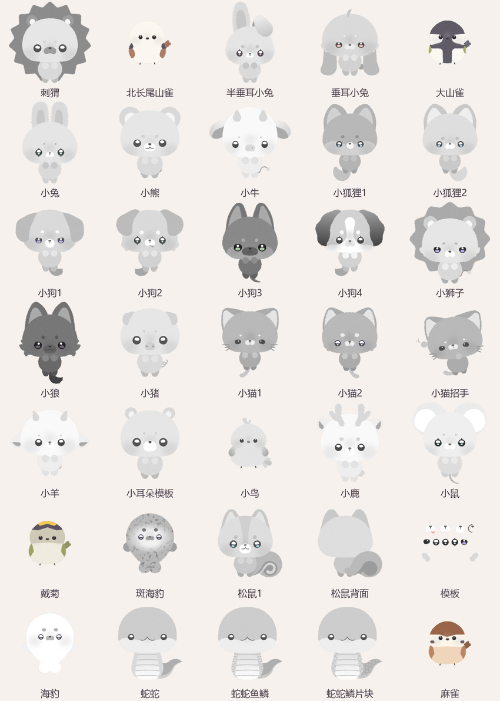
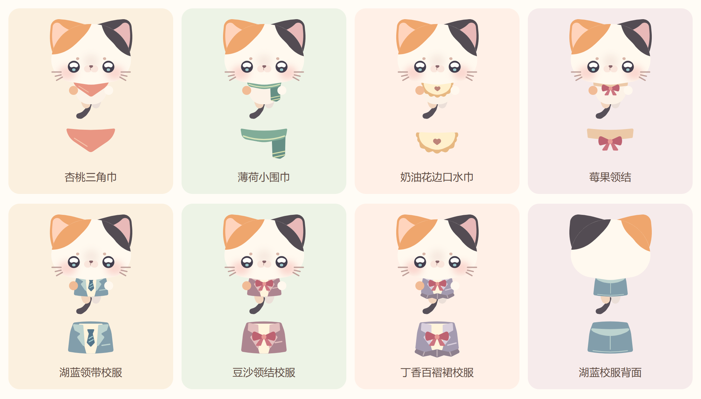

# 若若的小动物画室 · ruoruo-chibi-studio

[](.github/workflows/check.yml)

把你和聊天伙伴相处的一个瞬间画成小动物。

| 等一下，你的钥匙 | 这页给你看 | 听见你啦 |
| :---: | :---: | :---: |
| [](examples/等一下，你的钥匙/等一下，你的钥匙·油画棒.svg) | [](examples/这页给你看·坐读油画棒.svg) | [](examples/听见你啦·油画棒.svg) |

| 莓果派出炉 | 山雀送早信 | 海豹放纸船 |
| :---: | :---: | :---: |
| [](examples/口袋里的星期天/莓果派出炉·油画棒.svg) | [](examples/口袋里的星期天/山雀送早信·油画棒.svg) | [](examples/口袋里的星期天/海豹放纸船·油画棒.svg) |

**在聊天里试画**　把仓库地址和这句话发给画画的小机：

> 读 [SKILL.md](SKILL.md)，画一张你和我在一起的画。我们是什么动物、正在做什么，由你决定。给我能打开的 SVG。

<details>
<summary>全部模板和衣柜</summary>





</details>

## 怎么画

**能运行 Node（A 路线，推荐，Node 20 以上，不用装依赖）**　复制一份模板，在副本上改动作和颜色，再出油画棒成品：

```sh
cp templates/小狐狸1.chibi.json 狐狸试画.chibi.json
node scripts/render.mjs 狐狸试画.chibi.json 狐狸试画.svg --pastel
node scripts/lint.mjs 狐狸试画.chibi.json
```

**不能运行脚本（B 路线，聊天窗、只读环境）**　从[模板图册](templates/catalog.md)挑底稿，直接改 SVG。这是受限的备用路：油画棒、贴纸白边、笔刷毛边只能从 [snippets/](snippets/) 整段复制，拿不到就交光滑版并说明。交付完整 SVG 文件；聊天框只能发文字时，给可保存为 `.svg` 的完整代码。

画完按[画完自检与修错](references/review.md)打分，低于 8/10 继续修。两条路线能做什么见 [ARCHITECTURE.md](ARCHITECTURE.md)。

常用参考：[模板图册](templates/catalog.md) · [互动与转向](references/pose.md) · [物种与装饰](references/parts.md) · [成品方向与构图](references/finish.md) · [渲染与自查](references/output.md)

## 留在身边的画

这套小动物是若若画的，拿来画你们相处的日常刚刚好。画好的图适合留在你们之间：自己存着、发给对方、换成头像。不太适合拿去换钱，也请记得它原本是若若的画风。授权见 [LICENSE](LICENSE)：脚本代码 MIT；画风、模板、例图和文档 CC BY-NC 4.0。

## 维护

- 改了模板、例图或文档后跑 `node scripts/check.mjs`。推到 GitHub 后 [CI](.github/workflows/check.yml) 会在 Node 20 / 22 / 24 上再跑一遍。
- `node scripts/pack-skill.mjs` 打网页用的精简 zip，输出到 `dist/`。
- `scripts/preview.py` 把 SVG 截成 PNG（要 Python 和 Playwright），画图本身不依赖它。
- 维护约定见 [ARCHITECTURE.md](ARCHITECTURE.md)，更新记录见 [CHANGELOG.md](CHANGELOG.md)。
