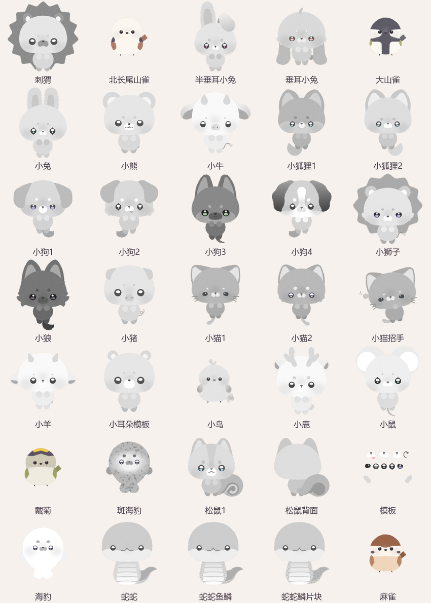

# 模板图册

先按耳形、身形和朝向选底稿。动作可改，模板保留脸形与比例。

| 底稿 | 看哪里 | 本地参数 |
|---|---|---|
| [刺猬](刺猬.svg) | 刺形背毛，露出圆耳，嘴努子和耳朵用重点色 | [JSON](刺猬.chibi.json) |
| [半垂耳小兔](半垂耳小兔.svg) | 单侧耳尖折向脸前 | [JSON](半垂耳小兔.chibi.json) |
| [垂耳小兔](垂耳小兔.svg) | 两耳垂过脸侧 | [JSON](垂耳小兔.chibi.json) |
| [小兔](小兔.svg) | 两耳直立 | [JSON](小兔.chibi.json) |
| [小狐狸1](小狐狸1.svg) | 深额花色，尾巴偏左 | [JSON](小狐狸1.chibi.json) |
| [小狐狸2](小狐狸2.svg) | 浅额花色，尾巴偏右 | [JSON](小狐狸2.chibi.json) |
| [小狗1](小狗1.svg) | 长垂耳，圆口鼻 | [JSON](小狗1.chibi.json) |
| [小狗2](小狗2.svg) | 短折耳，腮边毛 | [JSON](小狗2.chibi.json) |
| [小狗3](小狗3.svg) | 立耳，深色面罩 | [JSON](小狗3.chibi.json) |
| [小狗4](小狗4.svg) | 大垂耳、浅色脸区从额头到嘴 | [JSON](小狗4.chibi.json) |
| [小狼](小狼.svg) | 尖耳、两边三撮腮边毛、深色口鼻 | [JSON](小狼.chibi.json) |
| [小猫1](小猫1.svg) | 窄眼，尾尖偏左 | [JSON](小猫1.chibi.json) |
| [小猫2](小猫2.svg) | 圆眼，尾尖偏右 | [JSON](小猫2.chibi.json) |
| [小猫招手](小猫招手.svg) | 抬爪、抬脚和侧倾的动作底稿 | [JSON](小猫招手.chibi.json) |
| [小耳朵模板](小耳朵模板.svg) | 圆耳小兽通用底稿 | [JSON](小耳朵模板.chibi.json) |
| [小鼠](小鼠.svg) | 很大的圆耳，两瓣努子 | [JSON](小鼠.chibi.json) |
| [小熊](小熊.svg) | 圆耳、ω 嘴 | [JSON](小熊.chibi.json) |
| [小羊](小羊.svg) | 小短角、横向小垂耳、短尾 | [JSON](小羊.chibi.json) |
| [小牛](小牛.svg) | 水滴角、大垂耳、带鼻孔的宽口鼻、细尾巴尖一撮毛 | [JSON](小牛.chibi.json) |
| [小猪](小猪.svg) | 拼装：上窄下宽的凸圆盘猪鼻（若若画的）、往前耷拉的小耳（小狗1 耳朵缩小）、卷卷尾 | [JSON](小猪.chibi.json) |
| [小狮子](小狮子.svg) | 十二角星形大鬃毛垫在头后、圆耳、两边腮边毛、白色口鼻、细尾巴尖一撮毛 | [JSON](小狮子.chibi.json) |
| [小鹿](小鹿.svg) | 分叉鹿角、斜立耳、短尾 | [JSON](小鹿.chibi.json) |
| [小鸟](小鸟.svg) | 翅膀与细脚 | [JSON](小鸟.chibi.json) |
| [北长尾山雀](北长尾山雀.svg) | 小鸟外形 + 侧上方短尾，白身、深灰和棕两段翅膀色块 | [JSON](北长尾山雀.chibi.json) |
| [大山雀](大山雀.svg) | 黑头白颊、领带、橄榄绿翅膀色块 | [JSON](大山雀.chibi.json) |
| [麻雀](麻雀.svg) | 棕帽、黑颊斑、浅肚子 | [JSON](麻雀.chibi.json) |
| [戴菊](戴菊.svg) | 黄冠镶黑边、橄榄翅膀色块 | [JSON](戴菊.chibi.json) |
| [斑海豹](斑海豹.svg) | 灰斑、浅脸、身尾共色 | [JSON](斑海豹.chibi.json) |
| [松鼠1](松鼠1.svg) | 蓬松卷尾，正面 | [JSON](松鼠1.chibi.json) |
| [松鼠背面](松鼠背面.svg) | 背面和大尾巴 | [JSON](松鼠背面.chibi.json) |
| [模板](模板.svg) | 五官样板：眼型、嘴型零件参考（新的五官看五官库） | [JSON](模板.chibi.json) |
| [五官库](五官库.svg) | 从各动物模板拆出来的眼型 1–21、嘴型 1–24、腮边毛 1–6，每种标着出自哪只（[带标注的图](五官库.png)） | [JSON](五官库.chibi.json) |
| [部件库](部件库.json) | 拼装用的部件：叶形耳、锥形小角、大垂耳、条状尾+穗穗、两个鼻孔点、猪鼻、长喙（可调长短），`node scripts/kit.mjs` 放到底稿上 | [JSON](部件库.json) |
| [海豹](海豹.svg) | 浅色身尾一体 | [JSON](海豹.chibi.json) |
| [蛇蛇](蛇蛇.svg) | 长身盘尾、腹鳞 | [JSON](蛇蛇.chibi.json) |
| [蛇蛇鱼鳞](蛇蛇鱼鳞.svg) | 蛇蛇 + 腹鳞 + 身侧和尾巴的鱼鳞弧 | [JSON](蛇蛇鱼鳞.chibi.json) |
| [蛇蛇鳞片块](蛇蛇鳞片块.svg) | 蛇蛇 + 腹鳞 + 身侧和尾巴的圆角菱形鳞片 | [JSON](蛇蛇鳞片块.chibi.json) |
